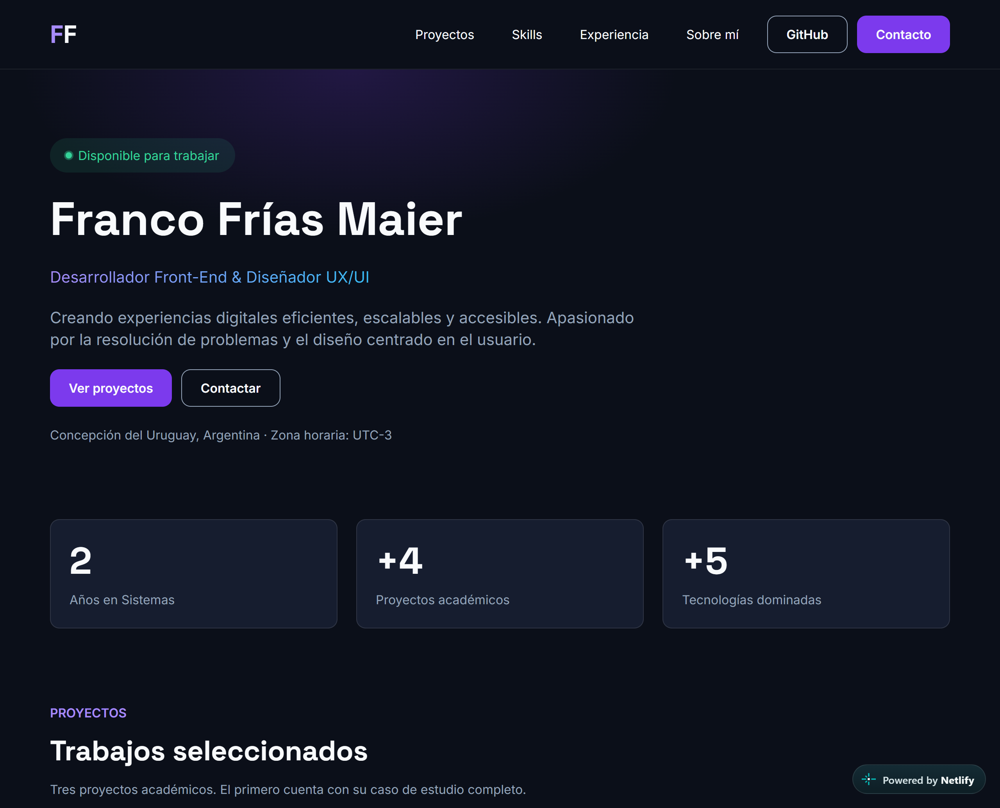
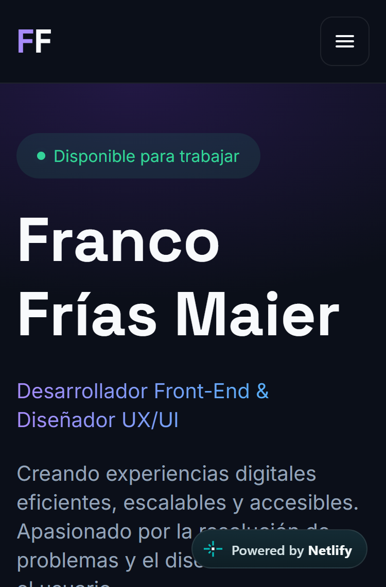
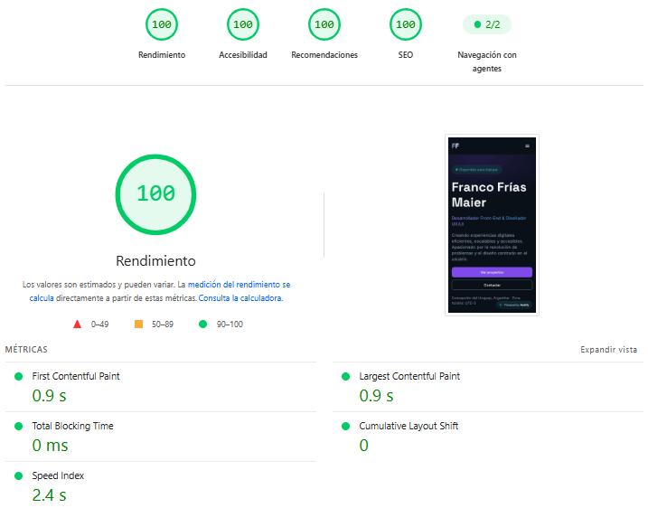

# Portfolio Web Personal — Franco Frías Maier

Trabajo Final de **Diseño UX/UI 2026** · Licenciatura en Sistemas de Información · FCyT UADER
Docente: Mg. Ernesto Ledesma

Portfolio one-page con navegación por anclas, una página interna de caso de estudio y una página 404 personalizada.

## Enlaces

| Recurso | Link |
| --- | --- |
| 🌐 Sitio publicado | https://franco-frias-portfolio.netlify.app/ |
| 🎨 Diseño en Figma | https://www.figma.com/design/xiFHLrEjPwcprlw4DJtDbt/tpFinal_Portafolio |
| 📁 Repositorio | https://github.com/francofriass/tp_final |

## Capturas

| Desktop (1280 px) | Mobile (375 px) |
| --- | --- |
|  |  |

**Lighthouse mobile** (PageSpeed Insights sobre la URL publicada):



## Stack

- **HTML5 semántico:** `header`, `nav`, `main`, `section`, `article` y `footer`. Un solo `h1` por página.
- **Tailwind CSS 3** compilado con el **CLI** (sin CDN), con los tokens del design system en `tailwind.config.js` y en variables `:root`.
- **JavaScript vanilla** para el menú mobile y las microinteracciones. Sin frameworks ni librerías.
- **Tipografías self-hosted:** Inter y Space Grotesk (2 familias, archivos variables `.woff2`), con `font-display: swap`, `preload` y fuentes de respaldo con `size-adjust` para evitar saltos de layout.
- **Imágenes en WebP** con `width` y `height` reales y `loading="lazy"` debajo del pliegue.
- **Netlify** conectado a GitHub: deploy automático en cada push a `main`, con headers de seguridad.

## Estructura del proyecto

```
tp_final/
├── index.html              # One-page con las 9 secciones
├── caso-estudio.html       # Caso de estudio de Cubrí Seguros
├── 404.html                # Página de error personalizada
├── netlify.toml            # Build, carpeta publicada y headers de seguridad
├── robots.txt
├── sitemap.xml
├── src/input.css           # Fuente de Tailwind: tokens, @font-face, base y componentes
├── tailwind.config.js      # Paleta, tipografías y breakpoints
├── package.json
├── assets/
│   ├── css/styles.css      # CSS compilado (se commitea)
│   ├── js/main.js          # Menú mobile y microinteracciones
│   ├── fonts/              # Inter y Space Grotesk (.woff2)
│   └── img/                # Capturas de proyectos, retrato, favicon y og-image
└── docs/                   # Capturas usadas en este README
```

## Cómo correrlo en local

```bash
npm install
npm run build   # compila src/input.css -> assets/css/styles.css (minificado)
npm run dev     # modo watch mientras se edita
```

Después se sirve la carpeta con cualquier servidor estático (por ejemplo `npx http-server .`).

## Despliegue (CI/CD con Netlify)

El sitio se publica en **Netlify**, conectado al repositorio de GitHub: cada push a `main` dispara un deploy automático. No se suben archivos a mano.

1. En Netlify: **Add new site → Import an existing project → GitHub** y elegir `francofriass/tp_final`.
2. Netlify lee la configuración de `netlify.toml`:
   - **Build command:** `npm run build` compila Tailwind con el CLI y arma la carpeta `_site` con `index.html`, `caso-estudio.html`, `404.html`, `robots.txt`, `sitemap.xml` y `assets/`.
   - **Publish directory:** `_site`.
   - **Headers de seguridad:** `X-Content-Type-Options`, `X-Frame-Options`, `Referrer-Policy` y `Permissions-Policy`.
3. En **Site configuration → Change site name**, el nombre del sitio es `franco-frias-portfolio`.
4. Desde ahí, cada push a `main` vuelve a publicar el sitio. Netlify sirve `404.html` automáticamente para las rutas que no existen.

La URL final está en este README y en la descripción del repositorio. El CSS compilado también queda commiteado.

## Proceso UX/UI (resumen)

Todo el proceso está documentado en Figma, una página por etapa:

| Página de Figma | Contenido |
| --- | --- |
| 1. Research | Proto-persona y escenario de uso, benchmark de 3 portfolios (Brittany Chiang, Ernesto Ledesma y un caso de Behance), moodboard y concepto visual: **Resolutivo, Eficiente, Práctico** |
| 2. Arquitectura | Sitemap y card sorting con 18 tarjetas |
| 3. Wireframes | Mobile, mobile con menú abierto y desktop, de página completa |
| 4. Design system | Paleta con roles y estados, escala tipográfica, espaciado (múltiplos de 4/8), grilla, componentes y reglas de uso |
| 5. Alta fidelidad | Desktop 1280 px, mobile 375 px y mobile con menú abierto |
| 6. Prototipo | Flujos desktop y mobile, con navegación por secciones y menú mobile |
| 7. Test de usabilidad | Plan, resultados y antes/después de los cambios |

### Orden de secciones

Inicio → Métricas → **Proyectos → Skills** → Experiencia → Sobre mí → Contacto → Footer.

Proyectos va antes que Skills por decisión tomada a partir del usuario objetivo definido en el research (Figma, página 1). La consigna permite cambiar el orden si se justifica.

### Test de usabilidad

Se testeó el prototipo en el celular con **3 personas**: 2 compañeros de la facultad y 1 persona de mi departamento.

| Tarea | Resultado |
| --- | --- |
| 1. Encontrar el email | 3/3 completada |
| 2. Decir qué proyecto tiene caso de estudio | 3/3 completada (tester 3 con dificultad baja, menos de 15 s) |
| 3. Decir qué estudia | 3/3 completada |
| 4. Decir si está disponible para trabajar | 3/3 completada |
| 5. Abrir el menú mobile | 3/3 completada |

| Tester | Facilidad percibida | Duración de la sesión |
| --- | --- | --- |
| 1 | 5/5 | 7 min 34 s |
| 2 | 5/5 | 5 min 02 s |
| 3 | 4/5 | 8 min 58 s (incluye card sorting) |

**Cambios aplicados a partir del test** (aplicados en Figma, páginas 5 y 6, y en el código del sitio):
1. **Chip "Caso de estudio":** en la tarjeta de Cubrí Seguros, "2026 · Caso de estudio" pasó de ser un texto simple a dos elementos: el año y un chip con la etiqueta. Así se distingue como etiqueta y se nota que ese proyecto tiene caso de estudio completo. <!-- FRANCO: completar el hallazgo del test que lo origina -->
2. **Textos de los enlaces de proyecto:** "Ver proyecto →" pasó a decir "Ver demo →" en Coffea (lleva al sitio publicado) y "Ver código →" en Mesa de Ayuda (lleva al repositorio del equipo). Así el texto dice a dónde lleva cada enlace.

**Hallazgos no aplicados:**
- Unir "Sobre mí" y "Experiencia": fue una preferencia personal de un tester, no un problema de uso. Además, la consigna pide las secciones separadas.
- Card sorting: lo hizo un solo tester y coincidió en parte con la arquitectura propuesta. La tarjeta con la palabra "badge" no se entendió. <!-- FRANCO: completar con la decisión tomada -->

El antes y después del Cambio 1 (desktop y mobile) está en Figma, página 7.

## Decisiones técnicas

| Decisión | Motivo |
| --- | --- |
| Tailwind compilado con el CLI | El CDN compila en el navegador, bloquea el render y empeora Performance. Con el CLI el CSS solo incluye las clases usadas y queda minificado. |
| Fuentes self-hosted con `preload` y fallback ajustado | Evita la petición a Google Fonts y el salto de layout (CLS) al cargar la fuente. |
| `#A78BFA` para texto violeta | El violeta de marca `#7C3AED` no llega a 4.5:1 como texto sobre el fondo oscuro, así que se usa solo como fondo de botones. |
| Tarjetas de proyecto con link "estirado" | Toda la tarjeta es clickeable sin anidar links, y el segundo link (demo de Cubrí) sigue funcionando aparte. |
| `scroll-margin-top` en las secciones | El header sticky no tapa los títulos al navegar por anclas. |
| Menú mobile con `aria-expanded`, `aria-controls`, cierre con Escape y overlay | Accesible con teclado y lector de pantalla, igual al prototipo. |
| `main` con `tabindex="-1"` | El link "Saltar al contenido" mueve el foco al contenido principal. |

## Microinteracciones

Todas animan solo `transform`, `opacity`, `filter` o colores (no afectan el layout ni Lighthouse). Se desactivan con `prefers-reduced-motion: reduce`, y sin JavaScript el contenido se ve igual.

| Microinteracción | Por qué |
| --- | --- |
| Hover de tarjetas de proyecto (se elevan) | Indica que toda la tarjeta es clickeable. Está definida en el design system. |
| Capturas de proyectos que recuperan el color en hover o foco | Refuerza la acción sobre la tarjeta. Solo en dispositivos con mouse: en el celular se ven normales siempre. |
| Entrada lateral del badge "Disponible para trabajar" | Lleva la mirada a la disponibilidad, una de las tareas del test de usabilidad. |
| Retrato con efecto 3D que sigue al mouse | Le da personalidad a la sección más personal del sitio. Sutil y solo con mouse. |
| Resaltado sutil de chips en Skills | Ayuda a recorrer las herramientas sin parecer un botón (sin cursor de mano ni movimiento). |
| Botón "Copiar email" con aviso accesible | El link `mailto:` depende de tener un programa de correo configurado. Copiar el email resuelve ese caso, y el aviso se anuncia con `aria-live`. |
| Brillo único en el borde del bloque de contacto | Marca el cierre del recorrido y el siguiente paso. Ocurre una sola vez. |

Las microinteracciones posteriores a la alta fidelidad (badge, capturas, retrato, chips y contacto) se agregaron durante la implementación; no formaron parte del test de usabilidad.

## Accesibilidad y performance

- Contraste AA (4.5:1) en todo el texto, con texto mínimo de 16 px.
- Navegación completa por teclado, con foco visible (anillo de 2 px `#38BDF8`) y link "Saltar al contenido".
- `lang="es"`, jerarquía de encabezados sin saltos e imágenes con `alt` descriptivo.
- Probado en 375, 768 y 1280 px, sin scroll horizontal.
- Metadatos completos: `title`, `description`, canonical, Open Graph, Twitter Card, `theme-color`, `color-scheme`, favicon, `robots.txt` y `sitemap.xml`.

### Lighthouse mobile (PageSpeed Insights)

<!-- COMPLETAR con los puntajes reales después de medir la URL publicada -->

| Categoría | Puntaje |
| --- | --- |
| Performance | _completar_ |
| Accessibility | _completar_ |
| Best Practices | _completar_ |
| SEO | _completar_ |

## Créditos y recursos

- **Inspiración de interfaz y componentes:** [Basecoat UI](https://basecoatui.com/). El diseño visual (paleta, tipografía y layout) es propio y fue definido en Figma.
- **Benchmark:** portfolios de Brittany Chiang, Ernesto Ledesma y un caso de Behance (detalle en Figma, página 1).
- **Tipografías:** [Inter](https://fonts.google.com/specimen/Inter) y [Space Grotesk](https://fonts.google.com/specimen/Space+Grotesk), licencia OFL, instaladas con Fontsource.
- **Estilos:** [Tailwind CSS](https://tailwindcss.com/).
- **Imágenes:** capturas propias de cada proyecto y retrato propio.
- **Mesa de Ayuda:** trabajo en equipo. El repositorio es de un compañero: [SantyStecklein/TPFinal-IS1](https://github.com/SantyStecklein/TPFinal-IS1). Mi parte: <!-- FRANCO: completar cuál fue tu parte --> _completar_.

## Declaración de uso de IA

Según la política de la cátedra, declaro qué se generó con IA y cómo lo revisé.

| Herramienta | Para qué se usó |
| --- | --- |
| **Antigravity** | Estructura base del maquetado y configuración del CLI de Tailwind. |
| **Claude (chat)** | Planificación del trabajo, armado de los prompts de implementación a partir de los textos y medidas de Figma, y revisión del README. |
| **Claude Code** | Ajuste final del código a Figma: tipografías self-hosted, conversión de imágenes a WebP, metadatos, caso de estudio, página 404, configuración de Netlify y microinteracciones. |

**Lo que no se generó con IA:** el diseño en Figma, el research, el test de usabilidad y sus datos, y los textos de proyectos, experiencia y biografía.

**Cómo lo revisé:** probé el sitio en 375, 768 y 1280 px, navegué solo con teclado, verifiqué los links, comparé cada sección con Figma y medí Lighthouse sobre la URL publicada. Revisé cada etapa antes de commitearla.